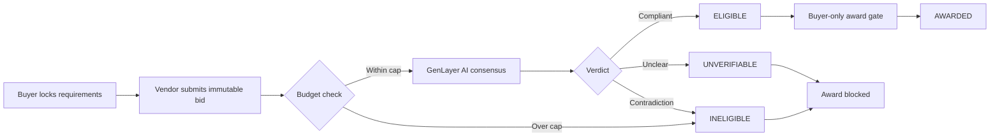

# BIDSEAL

### Consensus-verified procurement decisions on GenLayer

**BIDSEAL V1** is a standalone Intelligent Contract primitive: a buyer publishes immutable procurement requirements, vendors submit wallet-bound bids, and independent GenLayer validators assess whether a proposal meets every mandatory obligation. **Only a verified eligible bid can be awarded by the original buyer.**

**Status:** Live end-to-end demonstration on **GenLayer Studionet (chain ID 61999)**. This is a research/development contract, not a deployed payment or procurement platform.

[**Read the 2-minute reviewer guide**](REVIEWER.md) · [**View deployed contract**](https://explorer-studio.genlayer.com/address/0x182787964a480e2b76FFD664465fAb23b5f1B8DB) · [**Inspect live evidence**](docs/LIVE_EVIDENCE.md) · [**Open in Studio**](https://studio.genlayer.com/?import-contract=0x182787964a480e2b76FFD664465fAb23b5f1B8DB)

---

## The problem BIDSEAL solves

A lower price is not always a compliant bid. Conventional contract code can enforce `price <= ceiling`, but it cannot reliably understand open-text qualifications such as **“we supply the laptops but provide no warranty.”** Trusting one backend AI to approve a winner introduces a single point of judgment.

BIDSEAL makes the **eligibility decision a consensus-verified, consequential on-chain state transition**. The result governs which vendor the buyer may award.



## Live evidence — two opposite decisions

A buyer requested **20 refurbished laptops**, at least **16 GB RAM**, a **12-month warranty**, English support and delivery within **14 days**, with a price ceiling of **5000** (abstract test units, not a token transfer).

| Test | Vendor offer | AI / consensus decision | On-chain consequence |
|---|---|---|---|
| [TEST-001](https://explorer-studio.genlayer.com/tx/0x19318ccc53db6086c85e502332010b3a2d04ab3a0faffd73c1b7bea9214a0251) | 4800, all obligations explicitly accepted | **ELIGIBLE** — finalized, SUCCESS | [Award finalized](https://explorer-studio.genlayer.com/tx/0xe27f457e099218058338338f0594b4f1b25d42c2033e1e77b7278fc24c1a91e1); state reads **AWARDED** |
| [TEST-002](https://explorer-studio.genlayer.com/tx/0x91ff50c6b87e4c06ccf0c801a4c2e0965647ed9e6bee8126d3350a03336530cf) | 4500, expressly **no warranty** | **INELIGIBLE** — finalized, SUCCESS | [Invalid award rollback](https://explorer-studio.genlayer.com/tx/0x1f7ed9e5fc20c847e86d825fde2d9881efed93318e4941c35558d20b0cc2c88c); state still **OPEN** |

The cheaper offer was rejected **because it violated a mandatory natural-language condition**. A separate [vendor cancellation attempt](https://explorer-studio.genlayer.com/tx/0xaeca7a1c26bf9c43397fd3a7a131f56e56d1d2e803c54b78bdfc345bf15e29f2) also finalized with the expected authorization rollback.

**Status terminology matters:** the two evaluation transactions finalized with GenVM `SUCCESS`. Invalid award and unauthorized cancellation finalized with GenVM `ERROR` **by design**, with validator agreement on the rollback. Consensus `Accepted` is not the same as execution success.

These outcomes are based on signed transaction details and Studio readbacks provided by the builder. The [evidence file](docs/LIVE_EVIDENCE.md) records provenance and remaining independent cross-checks.

## How the intelligent decision works

The buyer-supplied requirements are the fixed policy. A vendor's offer is treated as **untrusted evidence**, never as instructions to the validator. Deterministic logic checks authorization, uniqueness, request status and price. For in-budget offers:

1. A leader uses an LLM to decide `ELIGIBLE`, `INELIGIBLE`, or `UNVERIFIABLE`.
2. Validators **independently rerun** the same assessment against the original requirements and offer.
3. The Equivalence Principle compares the decision-bearing label, not merely the answer's format.
4. A consensus-accepted label is stored. The buyer may execute `award` only for `ELIGIBLE`, once.

The contract deliberately returns `UNVERIFIABLE` for missing or ambiguous evidence and transient LLM failures. This is a judgment primitive, not an external supplier-verification oracle.

## Repository map

| Location | Content |
|---|---|
| [contracts/bidseal.py](contracts/bidseal.py) | Single independent GenLayer Intelligent Contract (V1) |
| [REVIEWER.md](REVIEWER.md) | Reviewer-first walkthrough and proofs |
| [docs/LIVE_EVIDENCE.md](docs/LIVE_EVIDENCE.md) | Test cases, receipts and exact on-chain observations |
| [docs/DEMO.md](docs/DEMO.md) | Short screencast script using actual evidence |
| [tests/](tests/) | 20 pure-Python shim test cases, including address normalization |
| [SECURITY.md](SECURITY.md) | Threat model, limits and disclosure |

## Test locally

```bash
python -m unittest discover -s tests -v
```

The included shim tests cover duplicate bids, ownership, budget, ambiguous terms, conflicting validator opinions, address normalization and allowed state transitions. **They do not replace a GenVM audit or real consensus.** The core `ELIGIBLE`, `INELIGIBLE`, successful award, and rejected-award scenarios were separately exercised on Studionet.

## What BIDSEAL does *not* do

It does **not** hold funds, perform escrow, verify real supplier identity, establish a legal contract, or prove delivery. The procurement case and prices are **synthetic**. This is an unaudited Studionet demonstration, not a production guarantee. Additional live edge-case coverage is documented in [REVIEWER.md](REVIEWER.md).

**MIT License** · [Security & disclosure](SECURITY.md)
